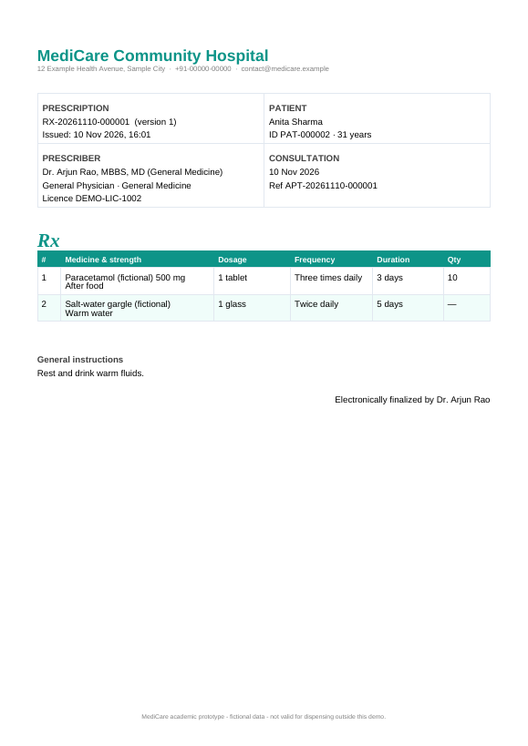

# MediCare — Smart Web-Based Medical Management System

A college final-year project: a secure, database-driven hospital/clinic management web application built with
**Java 21 + Spring Boot 4.1** (backend), **React 19 + Vite 8 + Tailwind CSS 4** (frontend) and **MySQL 8**.

> ⚠️ **Academic prototype.** All patients, diagnoses and records are fictional. The system does not make
> diagnoses or recommend treatments or doses; clinical content is entered only by authorised doctors.
> It is not certified for real clinical use (see *Security limitations* below).

* Architecture, verified tech stack, ER diagram and design decisions: [`docs/architecture/ARCHITECTURE.md`](docs/architecture/ARCHITECTURE.md)
* Phase-by-phase progress and acceptance checklist: [`docs/PROGRESS.md`](docs/PROGRESS.md)

---

## User roles

MediCare has exactly **four** roles:

| Role | Responsibilities |
|---|---|
| **PATIENT** | Registers, books appointments, sees own records, prescriptions, lab reports and invoices |
| **DOCTOR** | Consultations, prescriptions, **orders lab tests, uploads lab reports and reviews results** |
| **RECEPTIONIST** | Walk-in registration, scheduling, check-in and queue, **billing and payments** |
| **ADMIN** | Users, departments, doctors, settings, analytics, **lab test catalog, medicine inventory (stock, batches, expiry, low-stock alerts) and dispensing records** |

There are no separate laboratory or pharmacy logins.

> **Upgrading an older checkout:** the first migration (`V1`) was changed when the role model was reduced to these
> four roles. If you already ran an earlier version, drop and recreate `medicare_db` and `medicare_test`
> (section 2) before starting the backend; otherwise Flyway reports a checksum mismatch.

## 1. Prerequisites

| Software | Version | Check with |
|---|---|---|
| JDK | 21 (LTS) | `java -version` |
| Maven | 3.9+ | `mvn -v` |
| Node.js | 20.19+ or 22.12+ (Vite 8 requirement) | `node -v` |
| npm | 10+ | `npm -v` |
| MySQL Server | 8.0+ | `mysql --version` |
| Git | any | `git --version` |

IDE: IntelliJ IDEA (Community is fine) or VS Code with the *Extension Pack for Java*.

## 2. Create the MySQL databases

Log in as the MySQL root user (`mysql -u root -p`) and run:

```sql
CREATE DATABASE medicare_db   CHARACTER SET utf8mb4 COLLATE utf8mb4_unicode_ci;
CREATE DATABASE medicare_test CHARACTER SET utf8mb4 COLLATE utf8mb4_unicode_ci;
CREATE USER 'medicare_user'@'localhost' IDENTIFIED BY 'choose-a-strong-password';
GRANT ALL PRIVILEGES ON medicare_db.*   TO 'medicare_user'@'localhost';
GRANT ALL PRIVILEGES ON medicare_test.* TO 'medicare_user'@'localhost';
FLUSH PRIVILEGES;
```

You do **not** create any tables by hand. Flyway creates all of them from
`backend/src/main/resources/db/migration/V1__…V8__*.sql` when the backend starts.

## 3. Configure the backend

```bash
cd backend
cp .env.example .env        # Windows: copy .env.example .env
```

Edit `backend/.env` and set `DB_PASSWORD` and `TEST_DB_PASSWORD` to the password you chose above.
To use the demo accounts (section 4b), also set `DEMO_PASSWORD` to a strong password of your choice
(8+ characters with upper-case, lower-case, a digit and a special character, e.g. `Demo@2026`).
`backend/.env` is git-ignored. Spring Boot loads it automatically via `spring.config.import` in `application.yml`.

## 4. Run the backend

```bash
cd backend
mvn spring-boot:run
```

On first start Flyway logs `Successfully applied 8 migrations`. The API listens on **http://localhost:8080**.

* Health check: http://localhost:8080/api/health
* Swagger UI: http://localhost:8080/swagger-ui.html
* OpenAPI JSON: http://localhost:8080/v3/api-docs

### 4b. Optional: fictional demo accounts

Start the backend with the extra `demo` profile instead:

```bash
cd backend
SPRING_PROFILES_ACTIVE=dev,demo mvn spring-boot:run
```

On Windows PowerShell: `$env:SPRING_PROFILES_ACTIVE="dev,demo"; mvn spring-boot:run`

This creates the accounts below once. It is idempotent and never runs together with the `prod` profile.
All of them use the password you put in `DEMO_PASSWORD`.

| Role | E-mail |
|---|---|
| Administrator | admin@medicare.example |
| Receptionist | reception@medicare.example |
| Doctor (Cardiology) | dr.mehta@medicare.example, dr.nair@medicare.example |
| Doctor (General Medicine) | dr.rao@medicare.example |
| Doctor (Dermatology) | dr.khan@medicare.example |
| Doctor (Orthopedics) | dr.iyer@medicare.example |
| Patient | ravi.patient@medicare.example, anita.patient@medicare.example |

### 4c. E-mail without an SMTP server (development)

With `MAIL_ENABLED=false` (the default), the `dev` profile writes every outgoing e-mail as a text file to
`backend/mail-outbox/`. To test **Forgot password**, request a reset, open the newest file in that folder and
paste the link into the browser. Set `MAIL_ENABLED=true` and the `MAIL_*` SMTP variables to send real e-mails.

## 5. Run the frontend

In a second terminal:

```bash
cd frontend
npm install
npm run dev
```

Open **http://localhost:5173**. The *System status* card should show **Java backend UP** and
**MySQL database UP – Schema version V9 – Tables 36**, which proves React → Spring Boot → MySQL is connected.

## 6. Run the tests

Backend integration tests use the separate `medicare_test` database:

```bash
cd backend
mvn test
```

Frontend component/route tests:

```bash
cd frontend
npm test
```

## 7. Project structure

```
medical-management-system/
├── backend/                         Spring Boot (Maven)
│   ├── pom.xml
│   ├── .env.example
│   └── src/
│       ├── main/java/com/medicare/
│       │   ├── MedicalManagementApplication.java
│       │   ├── config/ security/ controller/ service/ repository/
│       │   ├── entity/ dto/ mapper/ enums/ exception/
│       │   └── validation/ notification/ reporting/
│       ├── main/resources/
│       │   ├── application.yml
│       │   └── db/migration/        Flyway V1..V9
│       └── test/                    JUnit 5 + Spring Boot Test
├── frontend/                        React + Vite
│   ├── package.json  vite.config.js  index.html
│   └── src/
│       ├── api/ services/ hooks/ context/ utils/
│       ├── components/ layouts/ routes/
│       └── pages/ public/ auth/ patient/ doctor/ reception/ admin/ prescriptions/ common/
└── docs/
    ├── architecture/ARCHITECTURE.md
    └── PROGRESS.md
```

## 8. API implemented so far

| Method | Path | Auth | Purpose |
|---|---|---|---|
| GET | `/api/health` | public | Backend + MySQL status, Flyway schema version, table count |
| GET | `/api/public/hospital-info` | public | Hospital name, contact, active departments |
| GET | `/api/auth/csrf` | public | Sets the `XSRF-TOKEN` cookie |
| POST | `/api/auth/register` | public | Patient self-registration (201 + patient profile) |
| POST | `/api/auth/login` | public | Starts a session; returns the current user |
| POST | `/api/auth/logout` | public | Ends the session (204) |
| GET | `/api/auth/me` | public | Current user (200), or 204 when not logged in |
| POST | `/api/auth/forgot-password` | public | Sends a reset link (always 202, same message) |
| POST | `/api/auth/reset-password` | public | Sets a new password with a single-use token |
| GET / PUT | `/api/account` | any role | Own name, phone, e-mail notification preference |
| PUT | `/api/account/password` | any role | Change own password (other sessions are signed out) |
| GET / PUT | `/api/patients/me` | PATIENT | Own demographic profile |
| GET | `/api/notifications` | any role | Own notifications (`unreadOnly`, `page`, `size`) |
| GET | `/api/notifications/unread-count` | any role | Badge count |
| PATCH | `/api/notifications/{id}/read`, `/api/notifications/read-all` | any role | Mark as read |
| GET | `/api/admin/users` | ADMIN | Search accounts (`search`, `role`, `active`, `page`, `size`) |
| PATCH | `/api/admin/users/{id}/status` | ADMIN | Activate / deactivate (`{"active":false,"reason":"…"}`) |
| PATCH | `/api/admin/users/{id}/unlock` | ADMIN | Clear a temporary login lock |
| GET | `/api/doctors` | public | Doctor directory (`search`, `departmentId`, `specialization`, `page`, `size`) |
| GET | `/api/doctors/{id}` | public | Doctor profile (404 if inactive) |
| GET | `/api/doctors/specializations` | public | Specializations for the filter |
| GET | `/api/public/departments` | public | Active departments with doctor counts |
| GET / PUT | `/api/doctor/profile` | DOCTOR | Own phone, qualifications, bio |
| GET / POST | `/api/admin/doctors` | ADMIN | Search / create doctors (creation e-mails a set-password link) |
| GET / PUT | `/api/admin/doctors/{id}` | ADMIN | View / update doctor, department, fee, consultation length |
| GET / POST | `/api/admin/departments` | ADMIN | All departments / create |
| PUT | `/api/admin/departments/{id}` | ADMIN | Rename / describe |
| PATCH | `/api/admin/departments/{id}/status` | ADMIN | Activate / deactivate (refused while active doctors remain) |
| GET / POST | `/api/admin/staff` | ADMIN | Receptionist and administrator accounts |
| GET | `/api/admin/patients` | ADMIN | Patient search (demographics only) |
| GET | `/api/admin/patients/duplicates` | ADMIN | Possible duplicate registrations |
| PUT | `/api/admin/patients/{id}` | ADMIN | Non-clinical correction with mandatory, audited reason |
| GET | `/api/doctors/{id}/schedule` | public | Weekly working hours |
| GET | `/api/doctors/{id}/slots?date=` | public | Generated slots: AVAILABLE / BOOKED / PAST / UNAVAILABLE |
| GET | `/api/doctors/{id}/next-available` | public | Earliest free slot (204 if none in the booking window) |
| POST | `/api/appointments` | PATIENT, RECEPTIONIST, ADMIN | Book (409 `SLOT_ALREADY_BOOKED` if taken) |
| GET | `/api/appointments/me?scope=UPCOMING\|PAST\|CANCELLED` | PATIENT | Own appointments |
| GET | `/api/appointments/me/summary` | PATIENT | Dashboard counts + next appointment |
| GET | `/api/appointments/{id}`, `/{id}/history` | owner / own doctor / front desk | Details and status history |
| PATCH | `/api/appointments/{id}/cancel` | owner, own doctor, front desk | Cancel with reason; releases the slot |
| PATCH | `/api/appointments/{id}/reschedule` | owner, front desk | Atomic move to another slot |
| PATCH | `/api/appointments/{id}/no-show` | own doctor, front desk | After the start time only |
| GET / PUT | `/api/doctor/availability` | DOCTOR | Weekly hours (affected bookings flagged, never cancelled) |
| GET / POST | `/api/doctor/leave`, PATCH `/api/doctor/leave/{id}/cancel` | DOCTOR | Leave / unavailability requests |
| GET | `/api/doctor/appointments`, `/api/doctor/dashboard` | DOCTOR | Calendar data and dashboard |
| GET / PUT | `/api/admin/doctors/{id}/availability` | ADMIN | Manage a doctor's hours |
| POST | `/api/admin/doctors/{id}/leave` | ADMIN | Record leave (approved immediately) |
| GET | `/api/admin/leave`, PATCH `/api/admin/leave/{id}/decision` | ADMIN | Leave approvals |
| POST | `/api/consultations` | DOCTOR | Start/re-open the consultation of your appointment (on its day) |
| GET | `/api/consultations/{id}`, `/by-appointment/{apptId}` | treating DOCTOR; own PATIENT (finalized) | Read (patients don't see observations/internal notes) |
| PATCH | `/api/consultations/{id}` | author DOCTOR | Save draft (send `version`; 409 if stale) |
| POST | `/api/consultations/{id}/finalize` | author DOCTOR | Finalize (diagnosis required); completes the appointment |
| POST / GET | `/api/consultations/{id}/amendments` | author / treating DOCTOR | Amend finalized notes with a reason; list previous versions |
| GET | `/api/doctor/patients`, `/api/doctor/patients/{id}/record` | DOCTOR (treatment relationship) | Own patients; full record (audited) |
| POST / PATCH | `/api/doctor/patients/{id}/allergies[/{aid}]`, `/conditions[/{cid}]` | treating DOCTOR | Record allergies and conditions |
| GET | `/api/patients/me/medical-history` | PATIENT | Allergies, conditions, finalized consultation timeline |
| POST | `/api/prescriptions` | author DOCTOR | Create a draft for your consultation (1–20 medicine lines) |
| PUT / DELETE | `/api/prescriptions/{id}` | author DOCTOR | Update a draft (send `version`; 409 if stale) / discard a draft |
| POST | `/api/prescriptions/{id}/finalize` | author DOCTOR | Finalize; supersedes the previous version; notifies the patient |
| POST | `/api/prescriptions/{id}/revisions` | author DOCTOR | Start version n+1 of a finalized prescription (reason required) |
| GET | `/api/prescriptions/{id}`, `/{id}/versions` | DOCTOR (author/treating), own PATIENT | Prescription and its version history |
| GET | `/api/prescriptions/{id}/pdf` | DOCTOR (author/treating), own PATIENT | A4 PDF (superseded copies are watermarked) |
| GET | `/api/consultations/{id}/prescriptions` | DOCTOR | Prescriptions of a consultation |
| GET | `/api/patients/me/prescriptions` | PATIENT | Search (medicine, doctor, RX no.), `doctorId`, `from`, `to`, `includeSuperseded` |
| GET | `/api/doctor/prescriptions` | DOCTOR | Prescriptions you issued (`status`, search, dates) |
| GET | `/api/reception/dashboard` | RECEPTIONIST, ADMIN | Today's counts per status, waiting queue, walk-ins |
| GET / POST | `/api/reception/patients` | RECEPTIONIST, ADMIN | Search patients (name, phone, e-mail, patient ID) / register a walk-in (no password; activation e-mail) |
| GET | `/api/reception/patients/{id}`, `/{id}/appointments` | RECEPTIONIST, ADMIN | Demographics and appointments (no clinical data, no visit reason) |
| PATCH | `/api/reception/patients/{id}/contact` | RECEPTIONIST, ADMIN | Update phone, address, emergency contact |
| GET | `/api/reception/appointments` | RECEPTIONIST, ADMIN | Day list (`date`, `doctorId`, `status`) with queue tokens |
| POST | `/api/appointments` (with `patientId`, `walkIn`) | RECEPTIONIST, ADMIN | Book for a patient (same concurrency-safe booking) |
| PATCH | `/api/appointments/{id}/check-in` | RECEPTIONIST, ADMIN | Check in (today only) and issue the next token for that doctor |
| GET | `/api/reception/queue` | RECEPTIONIST, ADMIN | Today's queue board (`date`, `doctorId`) |
| PATCH | `/api/reception/queue/{id}/skip`, `/{id}/requeue` | RECEPTIONIST, ADMIN | Skip a waiting patient / put them back |
| GET | `/api/doctor/queue` | DOCTOR | Your queue for today |
| GET / POST | `/api/admin/lab-tests` | ADMIN | Lab test catalog (incl. inactive) / add a test |
| PUT / PATCH | `/api/admin/lab-tests/{id}`, `/{id}/status` | ADMIN | Edit a test / activate or deactivate |
| GET | `/api/lab-tests` | DOCTOR, ADMIN | Active tests for ordering |
| POST | `/api/lab-orders` | DOCTOR (own consultation) | Order 1–20 tests (`priority`, optional clinical notes) |
| GET | `/api/lab-orders/{id}` | ordering/treating DOCTOR, own PATIENT | Order; patients see results only after finalization |
| PATCH | `/api/lab-orders/{id}/status` | ordering DOCTOR | `SAMPLE_COLLECTED`, `PROCESSING`, or `CANCELLED` with a reason |
| PUT | `/api/lab-orders/{id}/results` | ordering DOCTOR | Result values and comments as typed (send `version`; 409 if stale) |
| POST / DELETE | `/api/lab-orders/{id}/report` | ordering DOCTOR | Upload/replace the PDF (multipart `file`, max 5 MB) / remove it before finalizing |
| POST | `/api/lab-orders/{id}/finalize` | ordering DOCTOR | Lock results and report, release to the patient, notify them |
| GET | `/api/lab-orders/{id}/report` | ordering/treating DOCTOR, own PATIENT (finalized) | Download the PDF (audited) |
| GET | `/api/consultations/{id}/lab-orders`, `/api/doctor/lab-orders` | DOCTOR | Orders of a consultation / orders you placed (`status`, `search`) |
| GET | `/api/doctor/patients/{id}/lab-orders` | treating DOCTOR | All lab orders of your patient (audited) |
| GET | `/api/patients/me/lab-orders` | PATIENT | Own lab orders (`status`, `search`) |
| GET / POST | `/api/admin/inventory/medicines` | ADMIN | Medicines with usable/expired stock, next expiry, low-stock flag (`search`, `category`, `includeInactive`) / add |
| GET / PUT / PATCH | `/api/admin/inventory/medicines/{id}`, `/{id}/status` | ADMIN | Medicine with batches / edit / activate or deactivate |
| POST | `/api/admin/inventory/medicines/{id}/batches` | ADMIN | Receive stock as a new batch (future expiry, supplier, reference) |
| POST | `/api/admin/inventory/batches/{id}/adjustments` | ADMIN | `ADJUSTMENT_IN`, `ADJUSTMENT_OUT` or `STOCK_OUT` with a reason (never below zero) |
| POST | `/api/admin/inventory/batches/{id}/write-off` | ADMIN | Write off the remaining stock of an expired batch |
| GET | `/api/admin/inventory/transactions` | ADMIN | Stock history (`medicineId`, `type`) |
| GET | `/api/admin/inventory/alerts` | ADMIN | Low stock, expiring within the warning window, expired stock |
| GET | `/api/admin/dispensing/prescriptions/{rxNo}` | ADMIN | Finalized prescription's medicine lines with matching medicines and usable batches (audited) |
| POST / GET | `/api/admin/dispensing`, `/api/admin/dispensing/{id}` | ADMIN | Record a dispensing / list (`search`) / view a record |
| GET | `/api/billing/patients/{id}/billable` | RECEPTIONIST | Services not yet billed, with recorded prices; patient's outstanding balance |
| POST | `/api/billing/invoices` | RECEPTIONIST | Create an invoice from charge references, extra items, optional discount (reason required) |
| GET | `/api/billing/invoices`, `/{id}`, `/{id}/pdf` | RECEPTIONIST, ADMIN; own PATIENT (detail, PDF) | Search (`search`, `status`, `patientId`, `from`, `to`) / detail / PDF |
| POST | `/api/billing/invoices/{id}/payments` | RECEPTIONIST | Record a payment (`CASH`, `UPI_SIMULATED`, `CARD_SIMULATED`, `BANK_TRANSFER_SIMULATED`; reference only) |
| POST | `/api/billing/invoices/{id}/refunds` | RECEPTIONIST | Record a refund (reason in `notes`) |
| POST | `/api/billing/invoices/{id}/cancel` | RECEPTIONIST | Cancel an unpaid invoice (reason); its charges can be billed again |
| GET | `/api/patients/me/invoices` | PATIENT | Own invoices (`status`) |
| GET | `/api/admin/billing/summary` | ADMIN | Invoiced, collected, refunded and outstanding amounts (`from`, `to`; default this month) |
| GET / PUT | `/api/account/notification-preferences` | any logged-in user | E-mail master switch and categories (appointments, reminders, results, billing) |
| GET / PUT | `/api/admin/settings/reminders` | ADMIN | Reminder lead time (1–168 h) and whether reminders are e-mailed |
| POST | `/api/admin/reminders/run` | ADMIN | Send due reminders now (each reminder is still sent only once) |
| GET | `/api/admin/reminders` | ADMIN | Log of sent reminders |
| GET | `/api/admin/dashboard` | ADMIN | Statistics for `from`–`to` (default last 30 days, max 366): appointments by status/day/department, doctor workload, patients, revenue, lab orders, stock alerts |
| GET / PUT | `/api/admin/settings` | ADMIN | Hospital settings (time zone read-only); changes audited with field names |
| GET | `/api/admin/reports/{type}` | ADMIN | Preview (first 100 rows): `APPOINTMENTS`, `PAYMENTS`, `INVOICES`, `LAB_WORKLOAD`, `INVENTORY`, `AUDIT` |
| GET | `/api/admin/reports/{type}/export?format=CSV\|PDF` | ADMIN | Download (max 366 days / 10,000 rows; audited) |
| GET | `/api/admin/audit` | ADMIN | Audit log search (`actor`, `action`, `entityType`, `entityId`, `outcome`, `from`, `to`; default last 7 days) |

All POST/PUT/PATCH/DELETE requests need the `X-XSRF-TOKEN` header (the browser app handles this automatically).
To test with Postman, first send `GET /api/auth/csrf`, then copy the `XSRF-TOKEN` cookie value into an
`X-XSRF-TOKEN` header. Postman keeps the session cookie for later requests.

### Authentication & security behaviour

* Passwords: BCrypt (cost 12); policy is 8–64 characters with upper-case, lower-case, a digit and a special character.
* Five wrong passwords lock the account for 15 minutes; an admin can unlock it earlier.
* Login and reset requests are rate-limited per IP address (HTTP 429 with `Retry-After`).
* Error messages never reveal whether an e-mail address is registered.
* Reset links: 256-bit random token, only its SHA-256 hash is stored, valid 30 minutes, single use.
* Deactivating a user, or changing or resetting a password, ends that user's other sessions on their next request.
* Every login, failure, lockout, logout, password change and account change is written to `audit_logs`.
* Staff accounts (doctors, receptionists, admins) are created with a random, never-disclosed
  password; the new user receives a single-use *set your password* link (valid 72 h, `ACCOUNT_SETUP_HOURS`).
  In development the link is in `backend/mail-outbox/`.
* Doctors are never deleted (deactivate them in *Doctors* or *Users & access*); departments with active
  doctors can't be deactivated.

### Appointment scheduling rules

* Slots are generated from the doctor's weekly hours in steps of their consultation length, skipping the break.
  Approved leave or unavailability, existing bookings, past times, and dates beyond the booking window
  (`hospital_settings.booking_window_days`) are not bookable. All times are in the hospital time zone.
* **No double booking**: each booking locks the doctor's row, re-checks the slot, and reserves it in
  `appointment_slots` (unique key). `appointments` also has its own unique key on doctor, date and start
  time, ignoring cancelled rows. An automated test fires 10 simultaneous bookings and checks that exactly one wins.
* Patients can cancel or reschedule online up to `cancellation_window_hours` before the start (default 2 h),
  and reschedule at most 3 times. Reception can always help.
* Status changes follow SCHEDULED → CHECKED_IN → IN_PROGRESS → COMPLETED, plus CANCELLED / NO_SHOW. Every change
  is stored in `appointment_status_history`.
* Schedule changes and approved leave never cancel bookings. Affected appointments are flagged
  *needs rescheduling* and the patient is notified.
* The demo profile gives every demo doctor Mon–Sat 09:00–17:00 hours with a 13:00–14:00 break.

### Clinical records and privacy

* A doctor can see a patient's clinical record only with a **treatment relationship**, meaning at least one
  non-cancelled appointment together. Every record view and every denied attempt goes into `audit_logs`.
* Receptionists and administrators have no access to diagnoses or notes,
  enforced on the server.
* All clinical content is typed by the doctor. MediCare never suggests diagnoses, treatments or doses.
* A consultation can be started on the appointment day. If reception has not checked the patient in, starting it
  records an implicit check-in and issues a token. Finalizing requires a diagnosis and completes the appointment.
* Finalized notes are never overwritten. An amendment needs a reason, and the previous values are stored as
  a JSON snapshot (`consultation_amendments`).
* Patients see their finalized consultations, active allergies and conditions in *Medical history*, without the
  doctor's internal observations and notes, and can book a recommended follow-up directly.

### Prescriptions

* Only the consulting doctor writes the prescription. Each medicine line (name, strength, dosage, frequency,
  duration, instructions, quantity) is typed by the doctor; nothing is suggested or pre-filled.
* Drafts are private to the doctor. A **finalized prescription can never be edited**. *Revise* creates version 2
  under the same `RX-…` number with a mandatory reason; finalizing it marks version 1 **SUPERSEDED** (kept, and
  watermarked on its PDF).
* The patient is notified when a prescription is finalized. The e-mail never lists the medicines.
* Receptionists cannot read prescriptions. Administrators see only what dispensing needs: they look up a finalized
  prescription by its number and see the patient, the doctor and each medicine line with its quantity. Diagnosis,
  dosage instructions and notes are not shown, and every lookup is audited.



### Laboratory

* **Admins** maintain the test catalog: code, name, sample type, price, turnaround, and a unit and reference range
  shown for information. Tests are deactivated, never deleted. Each order keeps the name, price, unit and range it
  was ordered with, so later catalog edits don't change history.
* **Doctors** order tests from their own consultation. The order moves ORDERED → SAMPLE_COLLECTED → PROCESSING →
  COMPLETED, or is cancelled with a reason. Result values and comments are typed by the doctor. MediCare never
  flags, interprets or suggests anything.
* Finalizing needs an uploaded PDF. It makes results and report read-only, releases them to the patient and sends
  a notification (the message contains no results).
* **Patients** see their orders and the status. Results and the PDF appear only after finalization; the
  doctor's clinical notes are never shown to them.
* Other doctors with a treatment relationship can read completed orders. **Receptionists and administrators get
  403** for orders and reports, and every denied attempt and every download is written to `audit_logs`.
* **File safety:** at most 5 MB; the name must end in `.pdf`; the content must start with `%PDF-` and contain an
  `%%EOF` marker; PDFs with JavaScript, launch actions, embedded files or rich media are rejected. Files are saved
  under a random name in `UPLOAD_DIR/lab-reports/` (outside the web root), the user's file name is only shown,
  never used as a path, and the SHA-256 stored at upload is checked again on every download.

### User interface and accessibility

* **Hospital time everywhere:** the app loads the hospital's time zone at startup. "Today", every timestamp and
  every "has this appointment started?" check use it, whatever the device's clock says. A note under each page says
  so.
* **Navigation:** role menus are grouped into sections. Titled sections can be collapsed (remembered per browser);
  the section holding the current page always stays open, and the sidebar scrolls on its own.
* **Code splitting:** each page's code is loaded the first time it is opened. The main bundle is about 360 kB (it was
  680 kB), and the chart library loads only with the admin dashboard.
* **Accessibility (WCAG 2.1 AA):**
  * a "Skip to main content" link;
  * after every navigation, focus moves to the page heading and the browser tab title is updated;
  * text contrast is at least 4.5:1 (primary buttons and teal text use brand-700, muted text slate-500);
  * dialogs close with Escape, and form errors are announced;
  * every chart has a data table.
  * An automated **axe-core** scan of 52 pages across all roles, plus 6 interactive states (dialogs, mobile menu),
    reports no violations.

### Administration: dashboard, settings, reports, audit log

* The **dashboard** shows counts and amounts only: appointments by status, day and department, doctor workload, new
  and active patients, money collected per hospital day, lab orders by status, stock alerts and outstanding
  invoices. Each chart has a "Show data" table, so no figure depends on reading the chart alone.
* **Hospital settings:** every value is validated and every change is recorded in `audit_logs` with the fields that
  changed. The **time zone is fixed at installation**, because changing it would shift every stored appointment time.
* **Reports** (preview, CSV, PDF) contain operational data only: no diagnoses, visit reasons, prescriptions, test
  names or results.
  * CSV files are UTF-8 with a BOM and quote fields correctly. A cell starting with `= + - @` is prefixed with `'`
    so a spreadsheet won't run it as a formula.
  * Limits: 366 days and 10,000 rows. Every export is audited.
* **Audit log:** a read-only search by user, action, record, outcome and dates. The application has no way to
  edit or delete entries.

### Notifications and reminders

* Every event creates an **in-app notification**; these can't be switched off. E-mails go only to the account's own
  address and contain no diagnoses, prescriptions or results, just a notice and a link.
* **E-mail preferences** (*Account settings*): a master switch plus four categories (appointments, reminders,
  prescriptions and lab reports, billing). Security e-mails (password reset or change, account activation) are
  always sent; staff operational notices are in-app only.
* **Reminder job** (every 15 minutes, never between 21:00 and 08:00 hospital time):
  * *Appointment reminder:* once per appointment time, when a scheduled appointment starts within
    `reminder_hours_before` (default 24 h). Bookings made inside that window are skipped, because the confirmation
    was just sent. A rescheduled appointment gets a reminder for its new time.
  * *Follow-up reminder:* from two days before the follow-up date the doctor entered, unless the patient already
    has a later visit with that doctor. It includes the doctor's next free time; this is a scheduling hint, never
    clinical advice.
  * Each reminder is claimed by inserting a row with a unique key in its own transaction, so it is sent at most once
    even with several servers. Inactive accounts get nothing.
* When reception cancels an appointment, or a schedule change flags it as needing a new time, the patient's
  message includes the doctor's next free time.
* Administrators can change the lead time, switch reminder e-mails off, send due reminders immediately, and view
  the reminder log (*Reminders*).

### Billing and payments (receptionists)

* **What can be billed:** consultations (once the patient is checked in), lab tests of non-cancelled orders, and
  dispensed medicines, plus extra items typed by the receptionist.
  * Prices are the ones recorded at booking, ordering or dispensing, so later fee or price changes don't alter a
    bill. The browser sends only which charges to bill; the server looks up every price.
  * Each charge can be on only one active invoice (`invoice_items.billed_reference` is unique). Cancelling an unpaid
    invoice releases its charges.
* **Totals:** subtotal − discount (a reason is required) + tax at `hospital_settings.tax_rate_percent`. All money
  is calculated in exact decimals.
* **Payments** never exceed the balance due. The invoice row is locked while money is recorded; simultaneous
  payments were tested. Status moves UNPAID → PARTIALLY_PAID → PAID.
* **Refunds** need a reason and can't exceed what was received. A refund is a credit, for example a returned
  medicine: it does not reopen the balance. When everything received has been refunded, the invoice becomes
  REFUNDED. Payments and refunds are separate rows that are never edited or deleted.
* **No card data:** no payment gateway is connected, so non-cash methods are labelled *simulated* and only a
  reference is stored (UPI transaction ID, card terminal slip number). A reference with 13 or more digits in a row
  is rejected as a possible card number, in the browser and on the server.
* Patients see their own invoices and payments and download the PDF. They are notified when an invoice is issued
  and when money is recorded; messages contain amounts only. Administrators can read invoices and the billing
  summary but cannot record money. Doctors have no access to billing.

### Medicine inventory and dispensing (administrators)

* Medicines are deactivated, never deleted. Stock arrives as **batches** with a batch number, expiry date (must
  be in the future), quantity, optional purchase price and supplier.
* Every stock change (receipt, dispensing, adjustment, return to supplier, expired write-off) adds a row to the
  append-only stock history with the balance after it. Batch rows are locked during a change, and stock can never go
  below zero (checked by the service and by a database constraint).
* **Usable stock** excludes expired batches. **Alerts**: usable stock at or below the reorder level, batches
  expiring within `expiry_warning_days` (default 60, in `hospital_settings`), and expired batches still holding
  stock. Every morning at 08:00 hospital time each administrator gets one in-app summary.
* **Dispensing** works only against the current FINALIZED version of a prescription, looked up by its RX number:
  * Only catalog medicines whose name (or generic name) and strength match the prescribed line are offered.
    Comparison ignores case, spaces and punctuation. Giving a different medicine or strength needs a revised
    prescription from the doctor.
  * Only non-expired batches can be used; they are listed earliest expiry first, and the administrator picks the batch.
  * The total dispensed per line can't exceed the prescribed quantity. A line without a stated quantity can be
    dispensed once.
  * The prescription row and every batch involved are locked (batches in id order), so simultaneous dispensings
    can't oversell (tested with parallel requests).
  * Each dispensing gets a `DSP-yyyyMMdd-######` number, can be printed for the patient, and is audited.

### Reception and queue

* Receptionists register walk-in patients without choosing a password. The patient gets a single-use
  *set your password* link (valid 72 h). Duplicate e-mails are rejected.
* Reception books through the same locked, double-booking-safe API as patients, and may mark today's
  bookings as walk-ins. The reason for the visit goes only to the doctor; reception lists, the patient page
  and the printable confirmation never show it.
* **Check-in** is allowed only on the appointment day for SCHEDULED appointments. Each check-in gets the next
  token number for that doctor and day (1, 2, 3 …). Tokens are unique even under simultaneous check-ins (doctor
  row lock plus the `uk_queue_doctor_date_token` unique key; tested with parallel requests).
* The queue status follows the appointment automatically: WAITING → IN_CONSULTATION (doctor starts) →
  COMPLETED (doctor finalizes). Cancelling or recording a no-show marks the entry SKIPPED, and it cannot be put back.
  Reception can **skip** a waiting patient and **put them back** (same token).
* The doctor is notified when a patient checks in. Reception can update contact details but never sees
  diagnoses, notes, allergies or prescriptions.

## 9. Common errors and fixes

| Symptom | Cause / fix |
|---|---|
| `Access denied for user 'medicare_user'@'localhost'` | Wrong `DB_PASSWORD` in `backend/.env`, or the GRANT statements were not run. |
| `Could not resolve placeholder 'DB_USERNAME'` | `backend/.env` is missing, or you started the app from a folder other than `backend/`. |
| `Unknown database 'medicare_db'` | Run the `CREATE DATABASE` statements in section 2. |
| `Schema-validation: missing table` | Flyway did not run: check that `spring.flyway.enabled` is true and look for Flyway errors in the log. |
| `Validate failed: Migrations have failed validation` | A migration file was edited after it was applied. Never edit applied migrations; add a new `V9__…` file instead. For a throw-away dev DB you can drop and re-create `medicare_db`. |
| Port 8080 / 5173 already in use | Stop the other process or set `SERVER_PORT` (backend) / change `server.port` in `vite.config.js`. |
| Status card says *Backend unreachable* | The backend is not running, or `VITE_BACKEND_URL` points to the wrong port. |
| `403 CSRF_TOKEN_INVALID` on POST | The page was opened before the backend started. Reload so the app fetches `/api/auth/csrf`. |
| `DEMO_PASSWORD must be set…` on start-up | You enabled the `demo` profile without setting a strong `DEMO_PASSWORD` in `backend/.env`. |
| `ACCOUNT_LOCKED` when logging in | Five wrong passwords. Wait 15 minutes, or ask an admin to unlock it in *Users & access*. |
| `429 Too Many Requests` | Login/reset rate limit hit. Wait for the time in the `Retry-After` header (or raise `LOGIN_RATE_LIMIT` in dev). |
| Reset e-mail never arrives | With `MAIL_ENABLED=false` it is written to `backend/mail-outbox/` (dev profile) instead of being sent. |

## 10. Security limitations (academic prototype)

Before any real-world use this system would need, at minimum: a professional penetration test, a
regulatory/privacy compliance review (e.g. HIPAA / DPDP Act / GDPR as applicable), encryption at rest for the
database and uploaded files, TLS everywhere, centralised log monitoring, backup/disaster-recovery procedures,
dependency vulnerability scanning in CI, antivirus scanning of uploaded files (the PDF check does not look
inside compressed streams), multi-factor authentication for staff, and a formal clinical-safety review.
