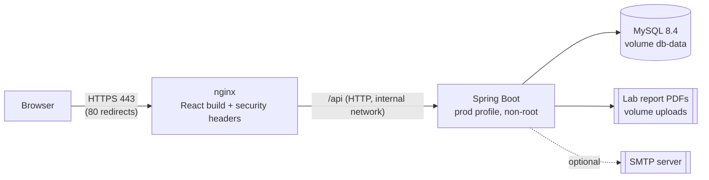

# Deployment guide

MediCare runs as three containers: **MySQL 8.4**, the **Spring Boot backend** (`prod` profile) and **nginx**, which serves the
React build, terminates HTTPS, adds the security headers and proxies `/api` to the backend.



## 1. Steps

```bash
cp .env.compose.example .env          # then edit: long random passwords, your public HTTPS URL, SMTP
# TLS certificate and key: deploy/certs/tls.crt and deploy/certs/tls.key (see deploy/certs/README.md)
docker compose up -d --build
docker compose logs -f backend        # wait for "Production configuration checks passed"
```

The first start creates the schema with Flyway (migrations V1–V14). There are no demo accounts in production.

**First administrator:** set `BOOTSTRAP_ADMIN_EMAIL` (and optionally `BOOTSTRAP_ADMIN_NAME`) in `.env`. When no active
administrator exists, the backend creates that account with a random password nobody knows and e-mails a single-use
"set your password" link (valid 72 h), so SMTP must work. Once an administrator exists the setting is ignored. All
other staff accounts are then created from the *Staff accounts* and *Doctors* pages and are invited the same way.

## 2. What the `prod` profile enforces

`ProductionSafetyCheck` stops the backend at startup, listing the problems by name (never their values), when:

* the `demo` profile is active;
* the session cookie is not `Secure`;
* `FRONTEND_BASE_URL` or any `CORS_ALLOWED_ORIGINS` entry is not an exact `https://` origin;
* `MAIL_OUTBOX_DIR` is set (e-mails would be written to disk);
* Swagger UI is enabled;
* `DB_PASSWORD` is shorter than 12 characters, or `DB_URL` is not a MySQL URL.

The profile also turns off Swagger and the API docs, marks the session and `XSRF-TOKEN` cookies `Secure`, and trusts
`X-Forwarded-*` headers only from private-network proxies (`server.forward-headers-strategy=native`). This keeps the
login rate limit and the audit log working with the real client IP. If `MAIL_ENABLED=false`, a warning is logged,
because password-reset and account-setup e-mails would not be delivered.

## 3. nginx

`frontend/deploy/nginx.conf` and `security-headers.conf`:

* HTTP → HTTPS redirect; TLS 1.2/1.3 only; HSTS for one year.
* `Content-Security-Policy` with `'self'` only (the app loads nothing from other sites); `frame-ancestors 'none'`,
  `X-Frame-Options DENY`, `nosniff`, `Referrer-Policy`, `Permissions-Policy`. The backend's own copies are hidden so every
  header is sent exactly once.
* Client-side routes fall back to `index.html`. Hashed files in `/assets/` are cached for a year; `index.html` is not cached.
* `client_max_body_size 6m` (lab report PDFs are limited to 5 MB by the backend).

## 4. What was verified, and how

| Check | Result |
|---|---|
| `docker compose config` | valid |
| Backend jar with `prod` and unsafe settings | refused to start, listing the problems |
| Backend jar with `prod` and safe settings | started; `/api/health` UP; Swagger and API docs 404 |
| This `nginx.conf` (on nginx 1.24, with `listen … ssl http2` because the `http2 on;` directive needs 1.25.1+) in front of the `prod` jar | HTTP→HTTPS redirect, client-side routes, every security header once, asset caching, `/api` proxy |
| Browser login through nginx over HTTPS | dashboard and reports work; `MEDICARE_SESSION` Secure + HttpOnly, `XSRF-TOKEN` Secure; no console errors |
| First start on an empty database with `BOOTSTRAP_ADMIN_EMAIL` | schema created, administrator created, setup e-mail sent; a second start created nothing |
| `docker compose up` | **not run**: this development environment has the Docker client but no Docker daemon |

## 5. Production checklist

- [ ] Real TLS certificate (for example Let's Encrypt); renewal scheduled.
- [ ] `.env` holds long random secrets and is readable only by the deploy user; never committed.
- [ ] SMTP configured (`MAIL_ENABLED=true`) so password resets and invitations reach users.
- [ ] Container image versions pinned by digest; images rebuilt for security updates.
- [ ] **Backups:** a nightly `mysqldump --single-transaction` of `medicare_db` **and** a copy of the `uploads` volume
      (lab reports), stored off the server and encrypted; restore tested regularly.
- [ ] Database and uploads volume on encrypted disks (data at rest).
- [ ] Logs collected centrally; alerts on repeated `LOGIN_FAILED` and `*_ACCESS_DENIED` audit entries.
- [ ] Firewall: only 80/443 open; MySQL is never exposed outside the Compose network.
- [ ] Antivirus scanning of uploaded files (the built-in PDF check does not look inside compressed streams).
- [ ] Before real patient data: a penetration test, a privacy and compliance review (e.g. DPDP Act / HIPAA / GDPR as
      applicable), multi-factor authentication for staff, and a clinical-safety review. This is an academic prototype.
