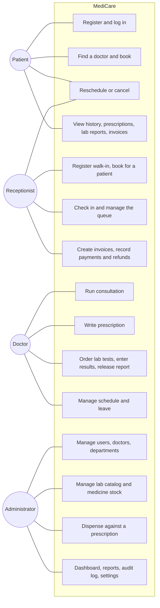
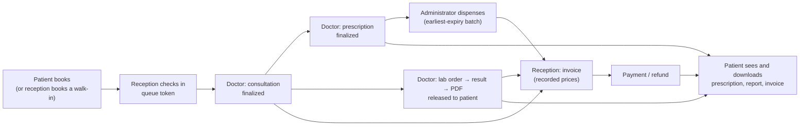
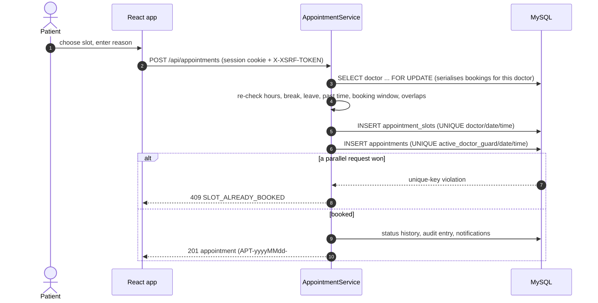
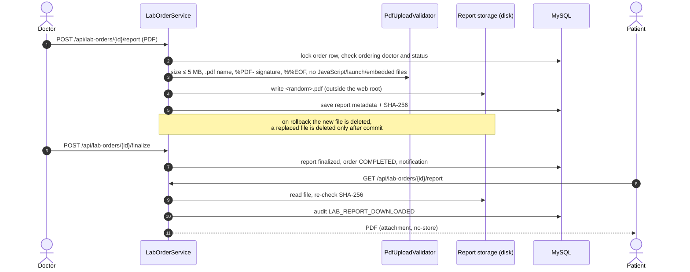
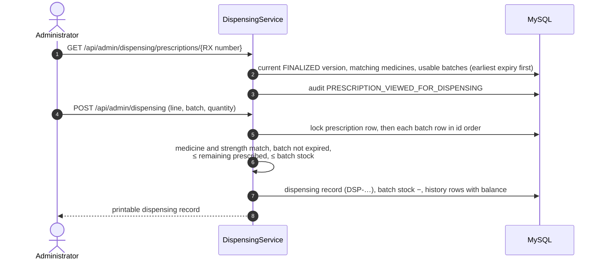
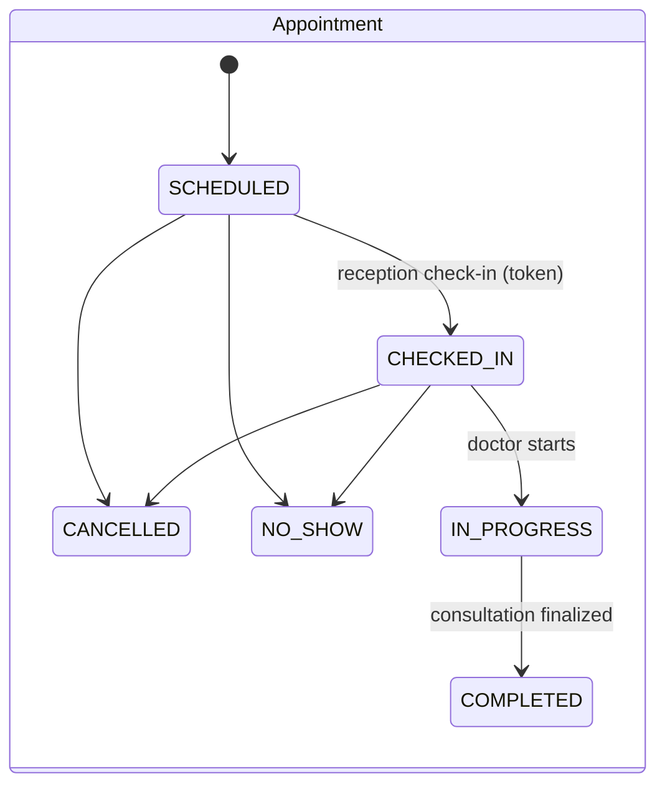
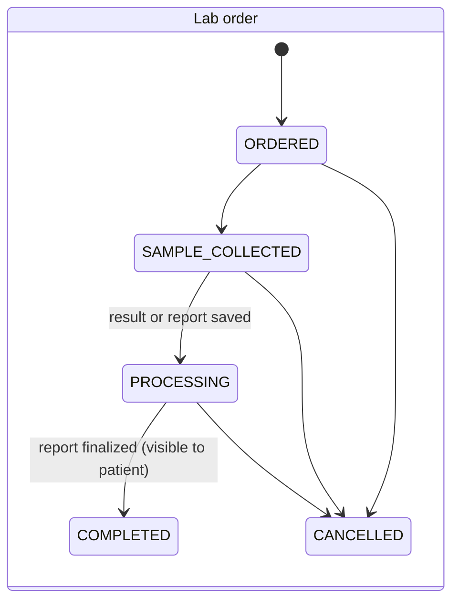
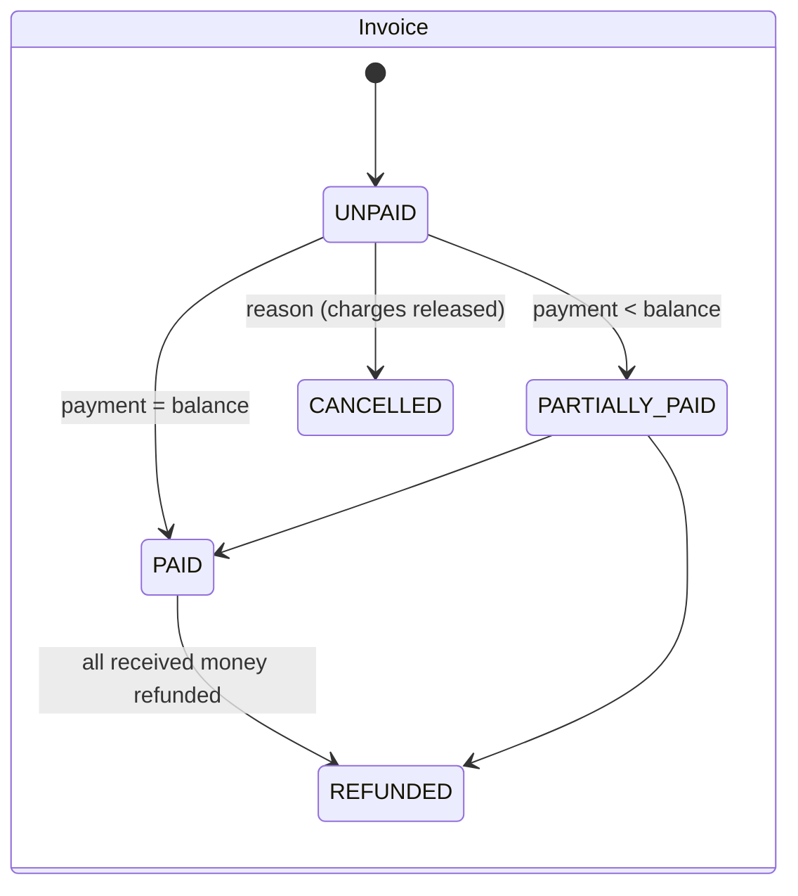
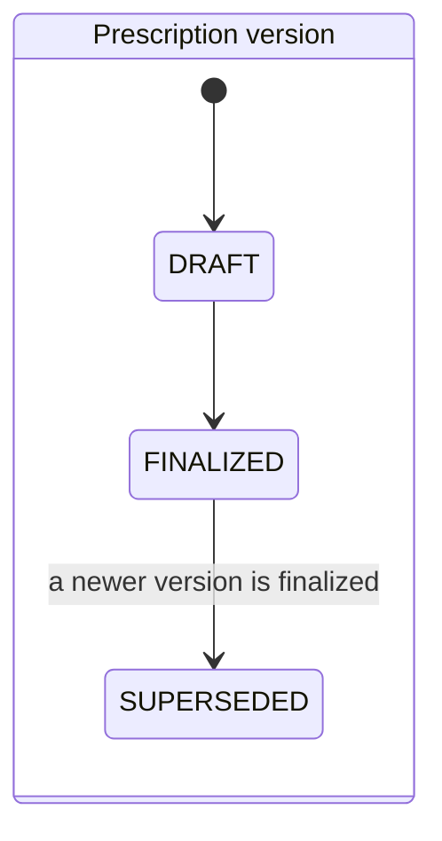

# Diagrams

The system architecture and the entity-relationship diagram are in [architecture/ARCHITECTURE.md](architecture/ARCHITECTURE.md),
and the deployment diagram is in [DEPLOYMENT.md](DEPLOYMENT.md). All diagrams are Mermaid; GitHub and most Markdown viewers render them.

## 1. Use cases by role

## 2. One visit across all roles

## 3. Booking without double booking

## 4. Lab report: upload and release

## 5. Dispensing without overselling

## 6. Status flows

