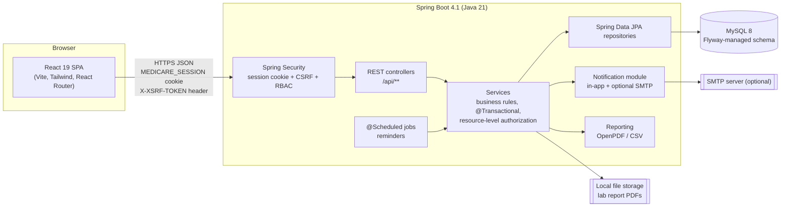
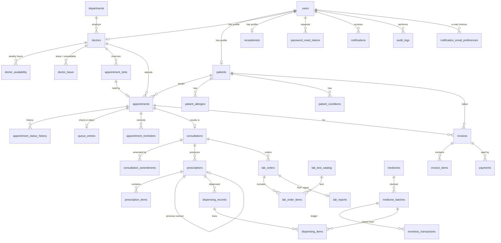

# MediCare — System Architecture

> Academic prototype. All data is synthetic. Not a certified clinical system.

## 1. Architecture overview

A **modular monolith**: one Spring Boot application (organised by layer and module) plus a separate React single-page app. No microservices.



In development, Vite (port 5173) proxies `/api` to Spring Boot (port 8080), so the browser sees **one origin**.
In production, the built SPA is served by nginx, which terminates TLS, adds the security headers and reverse-proxies `/api` (see [DEPLOYMENT.md](../DEPLOYMENT.md)).

### Authentication decision

**Server-side HTTP sessions with an HTTP-only cookie** (not JWT):

| Concern | How it is handled |
|---|---|
| Token theft via XSS | Session id lives in an `HttpOnly` cookie; JavaScript can't read it. Nothing is stored in localStorage. |
| CSRF | Spring Security `csrf.spa()`: readable `XSRF-TOKEN` cookie, echoed by Axios as the `X-XSRF-TOKEN` header. |
| Logout / revocation | `POST /api/auth/logout` invalidates the server session, so the cookie becomes useless immediately. |
| Expiry | 30-minute idle timeout (`SESSION_TIMEOUT`). |
| Session fixation | Session id is rotated on login. |
| Brute force | Per-account lockout after repeated failures + per-IP rate limit on login/reset (Phase 2). |

## 2. Technology stack (verified versions)

All versions were checked against Maven Central / npm on 2026-11-03 and built together successfully.

| Layer | Technology | Version |
|---|---|---|
| Language | Java (OpenJDK) | 21 LTS |
| Framework | Spring Boot (Spring Framework 7.0.10, Spring Security 7.1.2) | 4.1.2 |
| ORM | Hibernate ORM | 7.4.13 (managed by Boot) |
| JSON | Jackson | 3.1 (managed by Boot) |
| Migrations | Flyway + flyway-mysql | 12.4.0 (managed by Boot) |
| JDBC driver | MySQL Connector/J | 9.7.0 (managed by Boot) |
| API docs | springdoc-openapi (Swagger UI) | 3.2.0 |
| PDF | OpenPDF | 3.0.5 |
| Build | Maven | 3.9+ |
| Tests | JUnit 5, Mockito, Spring Boot Test, MockMvc | managed by Boot |
| Database | MySQL Server | 8.0+ (tested on 8.0.46) |
| Frontend | React / React DOM | 19.3.1 |
| Bundler | Vite (+ @vitejs/plugin-react 6.2.1) | 8.3.5 |
| CSS | Tailwind CSS (+ @tailwindcss/vite) | 4.3.4 |
| Routing | React Router | 7.18.5 |
| HTTP | Axios | 1.21.0 |
| Charts | Recharts | 3.10.1 |
| Forms | React Hook Form | 7.91.0 |
| Icons | lucide-react | 1.67.0 |
| Toasts | sonner | 2.0.8 |
| FE tests | Vitest 5.1, React Testing Library 16.3, jsdom 30 | — |
| E2E | Playwright | Phase 14 |

## 3. Backend package structure

```
com.medicare
├── config         AppProperties, JPA, OpenAPI configuration
├── security       SecurityConfig, JSON 401/403 handler, user details, access policies
├── controller     REST controllers (DTO in / DTO out only)
├── service        business logic, transactions, resource-level authorization
├── repository     Spring Data JPA repositories
├── entity         JPA entities (never returned from controllers)
├── dto            request/response records
├── mapper         entity ⇄ DTO mappers
├── enums          Role, AppointmentStatus, QueueStatus, ...
├── exception      ApiError + GlobalExceptionHandler + typed exceptions
├── validation     custom Bean Validation constraints (e.g. @StrongPassword)
├── notification   in-app + e-mail notification services, reminder scheduler
└── reporting      PDF/CSV generators, analytics aggregation
```

## 4. Database design

36 application tables (+ `flyway_schema_history`), created by migrations `V1`–`V14`. Later migrations add columns rather than editing released ones (e.g. V12 recorded prices, V13 refunds, V14 e-mail preferences).

### Changes vs. the 33 tables in the brief (with reasons)

| Change | Reason |
|---|---|
| **− two staff-profile tables** (laboratory staff, pharmacy staff) | The system has exactly four roles. Doctors handle lab orders and report uploads; administrators manage the test catalog, medicine inventory and dispensing records. |
| **+ `number_sequences`** | Concurrency-safe readable numbers (patient code, appointment reference, invoice no.) via `SELECT … FOR UPDATE`. Avoids `MAX(id)+1` races. |
| **+ `appointment_status_history`** | Appointments are updated in place (cancel / reschedule / status change); this table keeps the full, auditable history of each transition. |
| **+ `consultation_amendments`** | Finalised clinical notes are never silently overwritten: every amendment stores a JSON snapshot of the previous values, the doctor and a reason. |
| **+ `dispensing_items`** | One prescription line can be dispensed from several batches (FEFO), so dispensing needs line items. |
| `patients` requires a linked `users` row | Every patient (including walk-ins) gets a login identity; walk-ins receive a single-use "set your password" e-mail. Avoids duplicating name/email/phone in two tables. |
| `appointment_slots` is a **reservation ledger** | Free slots are *computed* from `doctor_availability` minus leave minus reservations. A row is written only when a slot is booked/blocked, so the table never fills with millions of empty slots. |
| `appointments.active_doctor_guard` generated column | A second, independent unique key `(doctor, date, start_time)` that ignores cancelled rows, so double-booking is impossible even if service code were wrong. |
| Prescriptions are versioned rows | `version_number` + `previous_version_id` + `SUPERSEDED` status, so finalised prescriptions are immutable. |

### Conventions
* `BIGINT AUTO_INCREMENT` primary keys; every relationship has a named foreign key.
* Status/enum columns are `VARCHAR` + `CHECK` constraints (MySQL ≥ 8.0.16 enforces them).
* Money is `DECIMAL(10,2)` / `DECIMAL(12,2)`. No floats.
* Audit timestamps are `DATETIME(6)` in **UTC** (the JDBC session time zone is forced to UTC). Appointment `DATE`/`TIME` values are local to the hospital's time zone (`hospital_settings.time_zone`).
* Soft deletion: `users.active`, `departments.active`, `medicines.active`, `lab_test_catalog.active`. Rows referenced by history are never hard-deleted.
* Optimistic locking (`version` columns) on rows edited concurrently.
* Stock can't go negative: `CHECK (quantity_available >= 0)`.
* Payments can't exceed the invoice total: `CHECK (amount_paid <= total_amount)`.

### Entity-relationship diagram



### Appointment double-booking prevention (Phase 4 design)

1. `SELECT … FROM doctors WHERE id = ? FOR UPDATE` serialises bookings for one doctor.
2. The service re-validates the slot: inside working hours, not in a break or leave, not in the past, inside the booking window, no overlap with an active appointment.
3. Insert or flip the `appointment_slots` row to `BOOKED`. `UNIQUE (doctor_id, slot_date, start_time)` rejects a concurrent duplicate.
4. Insert the appointment. `UNIQUE (active_doctor_guard, appointment_date, start_time)` is the final guard.
5. A unique-key violation maps to **HTTP 409 SLOT_ALREADY_BOOKED**.
6. Rescheduling does steps 1–4 for the new slot and releases the old slot **in the same transaction**.

## 5. Role & access model

Exactly four roles exist: PATIENT, DOCTOR, RECEPTIONIST and ADMIN.

| Role | Can access | Can never access |
|---|---|---|
| PATIENT | Own profile, appointments, finalised prescriptions, finalised lab reports, own invoices, own notifications | Other patients' data |
| DOCTOR | Own schedule; clinical records of patients with a treatment relationship (non-cancelled appointment with this doctor), including ordering lab tests, uploading lab reports and reviewing results. Every access is audit-logged. | Patients they don't treat |
| RECEPTIONIST | Patient demographics, scheduling, check-in, queue, invoices, payments | Diagnoses, clinical notes, prescriptions, lab results |
| ADMIN | Users, departments, schedules, settings, lab test catalog, medicine inventory (batches, stock, expiry, low-stock alerts), dispensing records against finalised prescriptions, aggregate analytics, audit logs | Clinical notes, diagnoses, lab results (only aggregate counts); dispensing shows medicine lines only |
